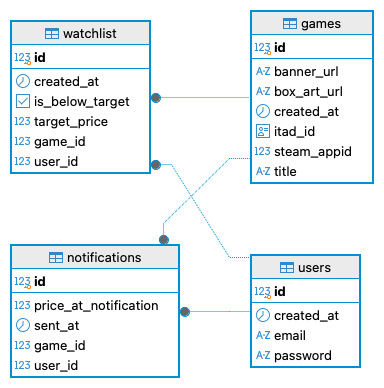

# 게임 가격 알림 서비스 (pricealert)

사고 싶은 게임을 찜해두고 원하는 가격을 정해두면, 그 가격 이하로 할인됐을 때 이메일로 알려주는 서비스입니다.
한 시간마다 가격을 확인하기 때문에, 세일이 떴을 때 놓치지 않고 바로 알 수 있습니다.
[IsThereAnyDeal(ITAD) API](https://docs.isthereanydeal.com/)를 활용해 게임 가격 정보를 조회하고, 매시 정각마다 배치로 가격을 확인해 알림을 발송합니다.

## 왜 만들었나

처음엔 쇼핑몰 상품 가격을 추적하는 서비스를 만들려고 했습니다. 그런데 상품 가격을 꾸준히 받아올 수 있는 API를 못 구했고(과거 가격을 알려주는 API가 마땅히 없었음), 약관상 가격을 DB에 저장하는 것도 막혀있는 경우가 많아서 포기했습니다.
게임은 ITAD라는 가격 비교 API가 있고, 세일이 자주 일어나서 목표가 알림 기능이 실제로 쓸모 있을 것 같아 게임으로 바꿨습니다.

## 기술 스택

- **Backend**: Java 21, Spring Boot 4.1.2, Spring Data JPA, Spring Security(세션 기반)
- **DB**: PostgreSQL (Docker)
- **API 문서화**: springdoc-openapi (Swagger UI)
- **외부 연동**: IsThereAnyDeal(ITAD) API, 네이버 SMTP(이메일 발송)
- **기타**: Lombok, Gradle

## 아키텍처

MVC 패턴으로 계층을 분리했습니다.

```
web          → Controller, DTO (요청/응답만 담당, 얇게 유지)
domain       → Service, Entity, Repository (도메인별: user / game / watchlist / notification)
external     → 외부 API 연동 (ItadClient, EmailNotifier)
batch        → 가격 확인 배치 (PriceCheckScheduler, PriceCheckService)
config       → SecurityConfig 등 설정
```

- Controller는 요청을 Service에 위임만 하고, 비즈니스 로직은 Service가 전담합니다.
- 외부 연동(ITAD API 호출, 이메일 발송)은 각각 별도 클라이언트 클래스로 분리해, 도메인 로직과 기술적 세부사항을 분리했습니다.
- 알림은 `Notifier` 인터페이스로 추상화하고 `EmailNotifier`가 이를 구현합니다. 알림 채널이 늘어나도(카카오톡, 문자 등) 알림을 발송하는 쪽 코드는 그대로 두고 구현체만 추가하면 됩니다.

### ERD



## 주요 기능

### 1. 회원가입 / 로그인
- 이메일 기반 회원가입, 세션 기반 로그인 (Spring Security)
- 비밀번호는 BCrypt로 암호화 저장

### 2. 게임 검색 및 등록
- 제목으로 ITAD API 검색 (자동완성)
- 스팀 상점 링크 또는 검색 결과 선택으로 게임 등록 (DB에 캐싱)

### 3. 찜하기 (Watchlist)
- 게임을 찜하고 목표가 설정
- 이미 찜한 게임이면 찜 취소, 목표가 수정 가능

### 4. 가격 확인 배치 & 알림
- 매시 정각(`@Scheduled(cron = "0 0 * * * *")`)마다 찜 목록 전체의 현재 가격을 ITAD API로 일괄 조회
- 목표가 이하로 떨어진 게임을 찜한 사용자에게 이메일 발송
- 한 번 알림을 보낸 뒤 다시 가격이 오르면 상태를 초기화해, 다음 할인 때 재알림이 가능하도록 처리

### 5. 게임 상세조회
- 현재가, 역대 최저가(전체/1년/3개월), 최근 3개월 가격 추이를 한 번에 조회
- 역대 최저가는 ITAD의 가격 조회 API, 가격 추이는 ITAD의 가격 변동 기록 API를 각각 호출해 조합

## 설계 과정에서 고민한 것들

- **배치 설계**: 전체 찜 목록에서 중복 게임 ID를 먼저 제거해 외부 API 호출 횟수를 최소화하고, 이후 사용자별로 설정한 서로 다른 목표가를 개별 비교/처리
- **ITAD API 호출 제한 대응**: ITAD API는 5분당 1,000회까지만 호출 가능합니다. 찜 목록이 많아지면 게임 ID도 많아지므로, 200개씩 나눠서 요청하고, 너무 많이 요청했다는 응답(429)을 받으면 응답에 포함된 대기시간만큼 기다렸다가 재시도하도록 구현했습니다. 재시도를 반복문 대신 재귀 호출로 처음 구현했는데, 재시도 횟수를 제한하지 않으면 무한정 재시도하거나 StackOverflowError가 날 수 있다는 걸 깨닫고 반복문 + 최대 재시도 횟수 제한으로 다시 설계했습니다.

## API 문서

서버 실행 후 Swagger UI에서 전체 API 명세를 확인할 수 있습니다.
```
http://localhost:8080/swagger-ui.html
```

## 실행 방법

```bash
# PostgreSQL 실행 (Docker)
docker start pricealert-db

# 애플리케이션 실행
./gradlew bootRun
```

`application.properties`에 ITAD API 키, DB 접속 정보, 메일 발송 계정 정보를 설정해야 합니다.
